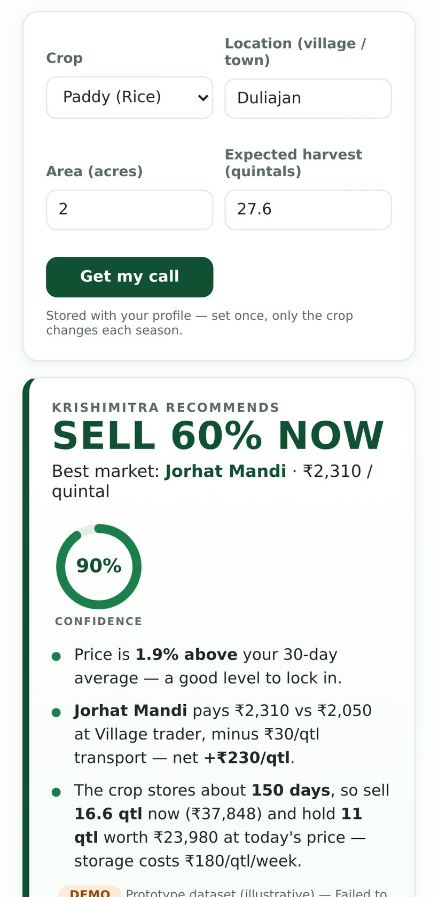
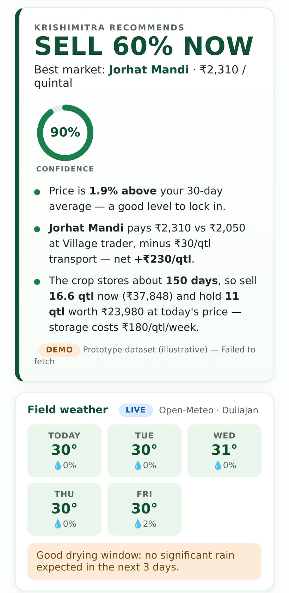
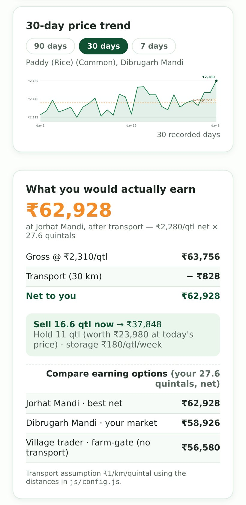
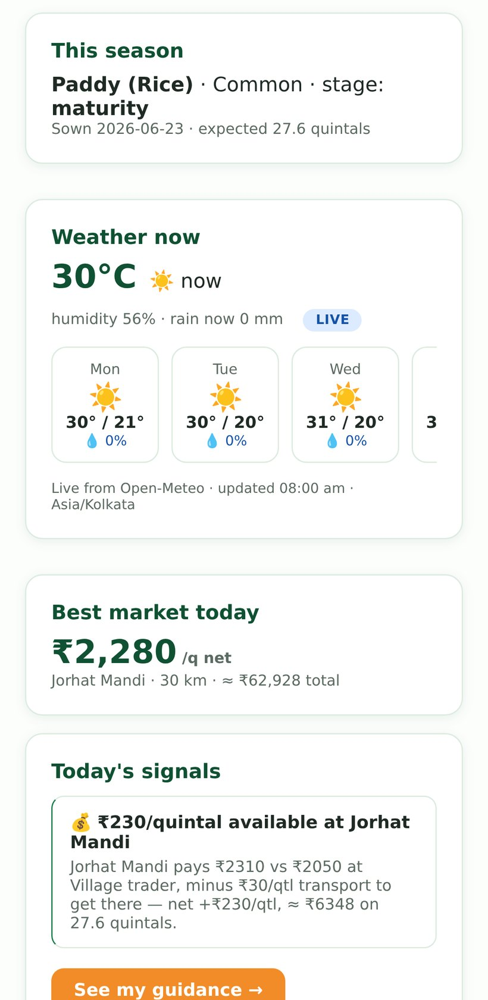
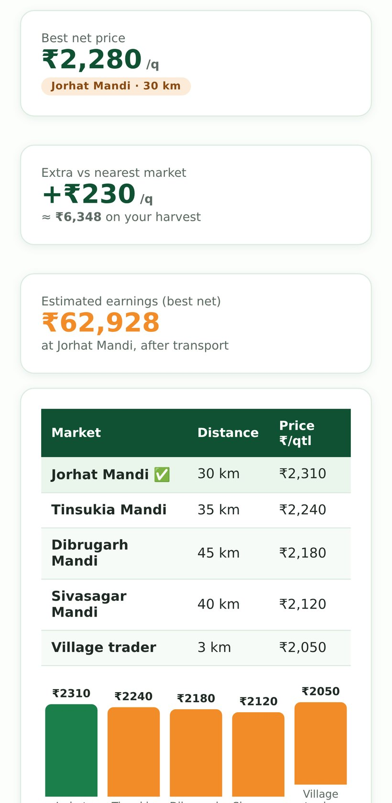
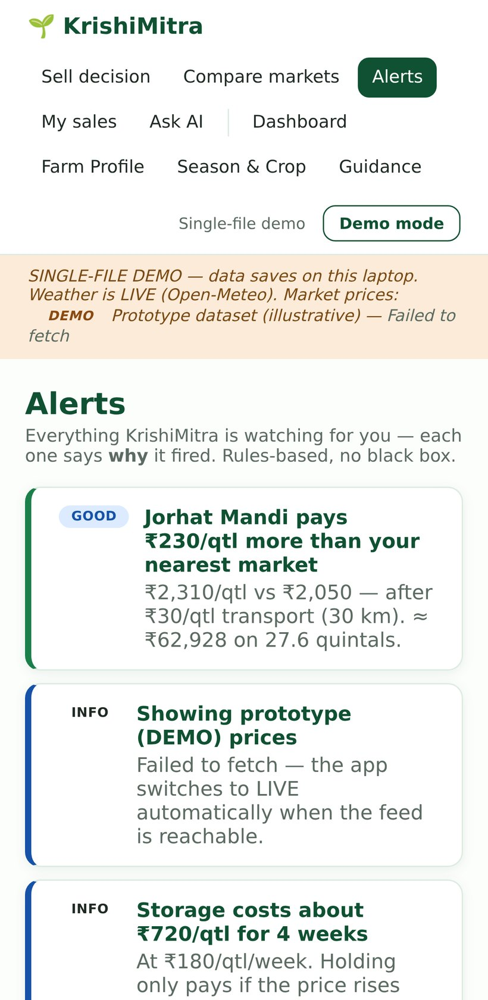
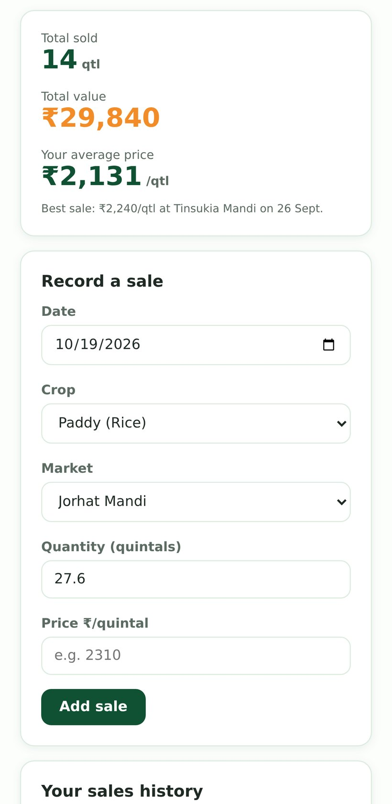

# 🌱 KrishiMitra

**Know your market. Choose your moment.**

A farm decision-support web app that turns **mandi prices + weather + the harvest window** into one
plain-language call: **sell now, wait, or sell part of it.**

Built as a **Progressive Web App** — installable on Android/iOS, works offline, no app store needed.

<p align="left">
  <a href="https://animated-croissant-38c5fc.netlify.app"><b>▶ Live demo</b></a> ·
  <a href="#-how-the-decision-engine-works">Decision engine</a> ·
  <a href="#-testing">158 tests</a> ·
  <a href="#-honest-limitations">Limitations</a>
</p>

---

## The problem

A small farmer in Assam has paddy ready. Three mandis are within 50 km, each paying a different
price. Transport costs differ. Rain is coming. Storage costs money every week.

**The decision needs four signals at once — and no one shows them together.**

Government price portals show *prices*. Weather apps show *rain*. Neither tells you **what to do**.

---

## What it does



The app takes four inputs — crop, village, area, expected harvest — and returns a **verdict with
reasons a farmer can verify**:

> **SELL 60% NOW** · 90% confidence
> Best market: **Jorhat Mandi · ₹2,310/qtl**
> - Price is **1.9% above** your 30-day average — a good level to lock in.
> - Jorhat pays ₹2,310 vs ₹2,050 at the village trader, minus ₹30/qtl transport — **net +₹230/qtl**.
> - The crop stores ~150 days, so sell **16.6 qtl now** (₹37,848) and hold **11 qtl** worth ₹23,980.

### Screens

| | |
|---|---|
|  |  |
| **Verdict** — recommendation, confidence ring, three reasons | **Earnings** — net after transport & storage, three options compared |
|  |  |
| **Dashboard** — season, live weather, best market today | **Compare markets** — ranked by *net* price, not sticker price |
|  |  |
| **Alerts** — rule-based, each one says *why* it fired | **My sales** — your own average becomes the benchmark |

---

## 🧠 How the decision engine works

No machine learning. No black box. **Arithmetic a farmer could do on paper** — which is the point.

### The core: net price, not sticker price

```
net_per_qtl = modal_price − (₹1/km/qtl × distance_km) − (₹180/qtl/week × weeks_stored)
```

A mandi 46 km away paying ₹2,360 can pay **less** than one 24 km away paying ₹2,310.
Most price apps never do this subtraction.

### The verdict

| Signal | How it's used |
|---|---|
| **30-day average** | Is today's price above or below the recent norm? |
| **Market spread** | How much more does the best mandi pay, net of transport? |
| **Rain risk** | Rain in the next 3 days during a sensitive stage → sell sooner |
| **Harvest window** | Is the crop actually ready? Maturity date vs today |
| **Storage economics** | Storage cost/week vs expected price gain |
| **Crop storability** | Paddy ~150 days, tomato ~7 days — changes the whole answer |

Output is one of **SELL ALL NOW · SELL 60% NOW · WAIT · STORE**, plus a **partial-sell split**
(sell X quintals now, hold Y) because real farmers don't sell everything at once.

### Confidence score

A composite of **data coverage + market spread + feed freshness + weather certainty**.
The app shows 90% *and* shows what went into it — a bare percentage with no explanation would be
dishonest.

---

## 📊 Where the data comes from

| Source | Provider | Freshness |
|---|---|---|
| **Mandi prices** | [AGMARKNET](https://agmarknet.gov.in) via [data.gov.in](https://data.gov.in) — Ministry of Agriculture & Farmers Welfare | Daily |
| **Weather** | [Open-Meteo](https://open-meteo.com) — 5-day forecast + hourly | Hourly |

**Resource ID:** `9ef84268-d588-465a-a308-a864a43d0070` (OGD Platform India, NDSAP licence)

### The honesty ladder

Every number on screen carries its provenance:

| Badge | Meaning |
|---|---|
| **LIVE** | Fetched from the government feed just now, shown with the ministry's own `arrival_date` |
| **LAST KNOWN** | Our saved copy of the last successful fetch, with its date |
| **DEMO** | Bundled prototype dataset, clearly labelled on every screen |

**The app never invents a price.** If the feed is unreachable, it says so rather than showing a
stale number as if it were live.

---

## 🏗️ Architecture

```
Browser
  │
  ├── 20 ES modules, ~2,500 LOC vanilla JS  (no framework, no build step)
  │     state.js · store.js · sell.js · markets.js · risk.js · guidance.js
  │     live-prices.js · weather.js · alerts.js · sales.js · chart.js · ui.js …
  │
  ├── Service worker (km-pwa-v2)
  │     • network-first navigations → offline fallback to cache
  │     • /api/* never cached — prices must never be stale
  │     • app shell cached on install
  │
  └── fetch → /api/agmarknet
                │
                └── Netlify Function (serverless, 114 lines)
                      • holds DATA_GOV_KEY — the key never reaches the browser
                      • server-to-server call, so CORS is a non-issue
                      • returns official records, or an honest 502
```

### Three deliberate decisions

**1. No framework.** Vanilla JS + one CSS file. The whole app is 2,500 lines a reader can follow
start to finish. For a decision tool that must run on a ₹6,000 Android phone over 3G, every
kilobyte of framework is a real cost.

**2. A serverless proxy instead of a direct browser call.** Two reasons: the data.gov.in key must
never ship to the client, and browser CORS to government servers is unreliable. The function is
114 lines and returns structured errors rather than failing silently.

**3. One build that runs everywhere.** The same source compiles to:
- a **multi-file PWA** (Netlify, installable)
- a **single self-contained HTML file** (double-click, no server, no internet — for the demo laptop)

---

## 🧪 Testing

**158 automated checks across 7 suites.** Not decoration — these caught real regressions.

| Suite | Checks | What it proves |
|---|---|---|
| `smoke.cjs` | 36 | Boots the real app in jsdom; every screen the demo shows renders with the right numbers |
| `site_check.py` | 29 | Served build: markup, assets, routing, content |
| `proxy_test.cjs` | 22 | Netlify Function contract: success shape, 400 on unknown crop, honest 502 |
| `pwa_test.cjs` | 21 | Manifest fields, icon sizes, SW registration, cache strategy |
| `standalone_check.cjs` | 20 | Single-file build is genuinely self-contained |
| `live_feed_test.mjs` | 15 | AGMARKNET mapping: dates, prices, districts |
| `nojs_test.cjs` | 15 | No-JavaScript snapshots render (WhatsApp/iOS in-app browsers) |

```bash
npm install
npm test              # smoke + standalone + proxy + pwa
python3 tests/site_check.py      # needs `python3 tools/serve_local.py` running
```

The single-file build is ~16 MB because it embeds a demo video as base64 — that is why it lives in
**Releases**, not in this repo.

---

## 🚀 Run it

### Option A — nothing installed (simplest)
Download `KRISHIMITRA.html` from [Releases](../../releases) and double-click it.
The whole app, no server, no internet.

### Option B — as a PWA
Open **[animated-croissant-38c5fc.netlify.app](https://animated-croissant-38c5fc.netlify.app)**
→ Chrome ⋮ → *Install app*. Works offline after the first load.

### Option C — from source

```bash
python3 tools/serve_local.py        # serves src/ and the price proxy on :8000
# optional: live government data
DATA_GOV_KEY=your_key python3 tools/serve_local.py
```

Get a free key: data.gov.in → Register → My Account → API Keys.
Without one, the government's shared sample key is used (heavily rate-limited).

### Deploy your own

```bash
# 1. push this repo
# 2. Netlify → "Add new site" → import repo
# 3. Site settings → Environment variables → DATA_GOV_KEY = <your key>
```

`netlify.toml` already configures the function, the `/api/agmarknet` redirect, and cache headers.

---

## ⚠️ Honest limitations

I would rather state these than have someone discover them.

| Limitation | Why |
|---|---|
| **Live prices don't work from non-Indian IPs** | `api.data.gov.in` geo-restricts to India. Netlify's servers are in the US, so the hosted demo falls back to **DEMO** data — visibly labelled. Running locally on an Indian connection gives real **LIVE** data. |
| **No database** | State lives in `localStorage`. Data does not sync across devices. Real deployment needs Postgres + auth. |
| **No real users yet** | This is a working prototype validated with domain research, not field-deployed with farmers. |
| **Prices are snapshots, not history** | AGMARKNET publishes a daily snapshot. The 30-day trend is built from data the app has itself observed, and says so. |
| **Decision support, not advice** | The UI states this. A farmer's own judgement and local knowledge come first. |

---

## 🗺️ What's next

- [ ] PostgreSQL + phone-OTP auth (data survives a phone change)
- [ ] Daily cron on an **Indian** VPS to build real price history
- [ ] Push notifications ("Jorhat crossed ₹2,350")
- [ ] Assamese / Hindi voice input — farmers type less than they speak
- [ ] Play Store release via TWA

---

## 🏆 Context

Built for **SPECTRONA 2026**, National Forensic Sciences University, Guwahati — **Top 8 finalist**.

Design assumptions are grounded in published data:
- **86.1%** of Indian holdings are small or marginal (Agriculture Census 2015–16)
- **₹1.53 lakh crore** lost annually to post-harvest gaps (NABCONS)
- Farmers capture roughly **one-third** of the final consumer price (RBI, Oct 2019)

---

## 📄 Licence

MIT — see [LICENSE](LICENSE).

Data belongs to the Government of India (NDSAP) and Open-Meteo. This project claims no ownership
of either.
